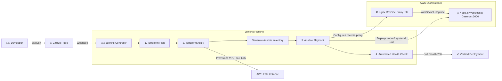

# 🚀 Jenkins CI/CD Pipeline: Terraform + Ansible

An end-to-end automated Infrastructure as Code (IaC) and Configuration Management (CM) CI/CD pipeline. 

Pushing code to Git triggers Jenkins to provision cloud infrastructure on **AWS via Terraform**, dynamically generate host inventories, and configure the servers with a **Real-Time Node.js WebSocket Chat Application behind Nginx via Ansible**.

---

## 📐 Architecture Overview



---

## 📂 Repository Structure

```
.
├── Jenkinsfile                      # Declarative multi-stage Jenkins pipeline
├── README.md                        # Documentation & interview guide
├── chat-app/                        # Node.js WebSocket Chat Application
│   ├── package.json                 # Dependencies (express, ws)
│   ├── server.js                    # HTTP + WebSocketServer, heartbeat, history buffer
│   ├── public/                      # Glassmorphism UI frontend
│   │   ├── index.html               # Chat layout, online users sidebar, emoji bar
│   │   ├── style.css                # Responsive dark mode stylesheet
│   │   └── app.js                   # Client-side native WebSocket event handlers
│   └── README.md                    # Local testing and architecture docs
├── terraform/                       # Infrastructure as Code
│   ├── versions.tf                  # Required Terraform & AWS provider versions
│   ├── providers.tf                 # AWS provider & default tagging
│   ├── variables.tf                 # Configurable variables (region, instance type, etc.)
│   ├── terraform.tfvars.example     # Example variable values
│   ├── vpc.tf                       # VPC, Internet Gateway, Subnet, Route Table
│   ├── security_group.tf            # Security Group (SSH 22, HTTP 80, App 3000)
│   ├── key_pair.tf                  # AWS Key Pair configuration
│   ├── main.tf                      # Ubuntu 22.04 EC2 instance & dynamic inventory generator
│   ├── outputs.tf                   # Public IP, DNS, and connection endpoints
│   └── templates/
│       └── inventory.tmpl           # Jinja template for dynamic Ansible inventory
├── ansible/                         # Configuration Management
│   ├── ansible.cfg                  # Ansible configuration (SSH optimizations, roles_path)
│   ├── playbook.yml                 # Master playbook orchestrating roles
│   ├── inventory/
│   │   └── hosts.example            # Sample inventory layout
│   └── roles/
│       └── webserver/               # Modular deployment role
│           ├── tasks/main.yml       # NodeSource LTS, npm install, systemd, Nginx proxy, health check
│           ├── handlers/main.yml    # Systemd restart & reload handlers
│           ├── templates/
│           │   ├── chat-app.service.j2 # Systemd service unit for Node.js daemon
│           │   └── nginx-chat.conf.j2  # Nginx WebSocket reverse proxy configuration
│           └── vars/main.yml        # Role variables (ports, deploy directory)
└── scripts/
    ├── setup_jenkins.sh             # Automated setup script for Jenkins Controller
    └── test_local.sh                # Local dry-run and syntax validation script
```
│           ├── handlers/main.yml    # Systemd restart & reload handlers
│           ├── templates/index.html.j2 # Dynamic responsive web application template
│           └── vars/main.yml        # Role variables (port, title, version)
└── scripts/
    ├── setup_jenkins.sh             # Automated setup script for Jenkins Controller
    └── test_local.sh                # Local dry-run and syntax validation script
```

---

## 🛠️ Step-by-Step Implementation Guide

### Step 1: Provision Jenkins Controller & Tools
If setting up a fresh Jenkins controller VM (Ubuntu 22.04 LTS), execute the provided setup script:

```bash
chmod +x scripts/setup_jenkins.sh
./scripts/setup_jenkins.sh
```

This installs:
- Java 17 (OpenJDK)
- Jenkins LTS
- HashiCorp Terraform CLI
- Ansible CLI
- AWS CLI v2
- Git, netcat, and Python tools

Retrieve your initial unlock key:
```bash
sudo cat /var/lib/jenkins/secrets/initialAdminPassword
```

### Step 2: Install Jenkins Plugins
Inside **Manage Jenkins > Plugins > Available Plugins**, install the following:
1. **Git Plugin**
2. **Pipeline**
3. **Terraform Plugin**
4. **Ansible Plugin**
5. **SSH Agent Plugin**
6. **Credentials Binding Plugin**
7. **AnsiColor Plugin**

---

### Step 3: Configure Credentials in Jenkins
Navigate to **Manage Jenkins > Credentials > System > Global credentials > Add Credentials**:

#### 1. AWS Credentials
- **Kind**: `AWS Credentials` (or `Secret text` / `Username with password`)
- **ID**: `aws-credentials` *(Must match the ID in `Jenkinsfile`)*
- **Access Key ID**: `<Your-AWS-Access-Key-ID>`
- **Secret Access Key**: `<Your-AWS-Secret-Access-Key>`

#### 2. SSH Private Key
- **Kind**: `SSH Username with private key`
- **ID**: `ec2-ssh-key` *(Must match the ID in `Jenkinsfile`)*
- **Username**: `ubuntu`
- **Private Key**: Paste your private key (`id_rsa` or AWS `.pem` private key content)

> 💡 **Public Key in Terraform**: Ensure your corresponding SSH public key is available either at `~/.ssh/id_rsa.pub` or set `ssh_public_key` in `terraform/variables.tf`.

---

### Step 4: Create the Jenkins Pipeline Job

1. Go to Jenkins Dashboard -> **New Item**.
2. Enter name: `jenkins-tf-ansible-pipeline`.
3. Select **Pipeline** and click **OK**.
4. In the **General** tab:
   - Check **This project is parameterized** (parameters will auto-populate after the first build).
5. In the **Build Triggers** section:
   - Check **GitHub hook trigger for GITScm polling**.
6. In the **Pipeline** section:
   - **Definition**: `Pipeline script from SCM`
   - **SCM**: `Git`
   - **Repository URL**: `https://github.com/<your-username>/<your-repo-name>.git`
   - **Branch**: `*/main`
   - **Script Path**: `Jenkinsfile`
7. Click **Save**.

---

### Step 5: Configure GitHub Webhook

1. In your GitHub repository, navigate to **Settings > Webhooks > Add webhook**.
2. **Payload URL**: `http://<YOUR-JENKINS-IP>:8080/github-webhook/`
3. **Content type**: `application/json`
4. Which events would you like to trigger this webhook? Select **Just the push event**.
5. Click **Add webhook**.

---

## ⚙️ Pipeline Lifecycle Stages

| Stage | Action | Description |
|---|---|---|
| **Stage 0: Checkout & Tools** | Pre-flight verification | Verifies availability of `git`, `terraform`, `ansible`, and `aws` CLIs. |
| **Stage 1: Terraform Plan** | `terraform plan` | Generates a deterministic preview binary (`tfplan.binary`). |
| **Stage 2: Terraform Apply** | `terraform apply` | Provisions AWS VPC, Subnet, Security Groups, EC2 instance, and writes the `ansible/inventory/hosts` file. |
| **Stage 3: Ansible Configure** | `ansible-playbook` | Connects via SSH to install Nginx, deploy the responsive landing page, and start services. |
| **Stage 4: Health Check** | Automated `curl` | Runs a smoke test asserting HTTP 200 OK from the deployed web server. |
| **Stage 5: Teardown (Optional)**| `terraform destroy` | Parameterized destroy action to tear down all cloud resources with one click. |

---

## 🎯 What This Depicts to an Interviewer

When discussing this project in a DevOps / Cloud Platform interview, highlight the following core concepts:

### 1. Separation of Concerns (Orchestration vs Configuration)
- **Terraform (Immutable Infrastructure)**: Handles infrastructure lifecycle (VPC, Subnet, Internet Gateway, Security Groups, EC2 compute). Terraform excels at state-driven cloud resource lifecycle.
- **Ansible (Configuration Management)**: Handles host configuration (packages, security policies, config files, application services). Ansible is agentless, idempotent, and connects over SSH.

### 2. Solving the Dynamic Inventory Problem
- *Interview Question*: *"How does Ansible know the IP address of newly created cloud instances in CI/CD?"*
- *Solution implemented*: Terraform renders `terraform/templates/inventory.tmpl` directly into `ansible/inventory/hosts` upon `apply`, leveraging `local_file` and `templatefile()`. Furthermore, the Jenkinsfile dynamically queries `terraform output -raw instance_public_ip` for fallback verification.

### 3. Handling SSH Latency & Boot Race Conditions
- *Interview Question*: *"EC2 instances take time to boot. How do you prevent Ansible from failing immediately with connection refused?"*
- *Solution implemented*:
  1. Pipeline stage checks TCP port 22 readiness with `netcat` loop.
  2. Ansible playbook utilizes `wait_for_connection` with a 120-second timeout before running tasks.

### 4. Idempotency & CI/CD Safety
- Terraform plans are saved to an explicit binary file (`-out=tfplan.binary`), ensuring that the exact inspected plan is what gets applied.
- Ansible tasks use declarative states (`state: present`, `state: started`), ensuring safe re-execution without configuration drift.
- The pipeline provides an optional manual approval gate for production environments.

---

## 🧪 Local Testing Before Pushing

Run the validation script to verify Terraform and Ansible files locally:

```bash
./scripts/test_local.sh
```

To run Terraform manually from your terminal:

```bash
cd terraform
cp terraform.tfvars.example terraform.tfvars
terraform init
terraform plan
terraform apply
```

To run Ansible manually against the generated inventory:

```bash
cd ansible
ansible-playbook -i inventory/hosts playbook.yml
```
